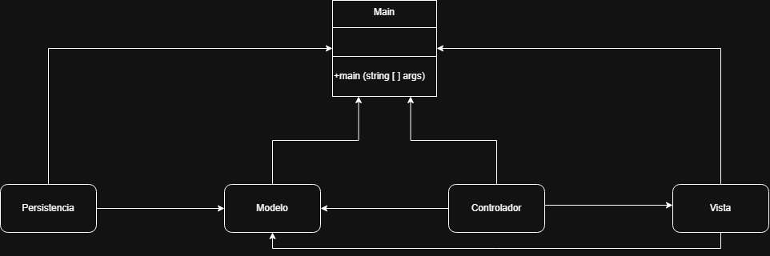
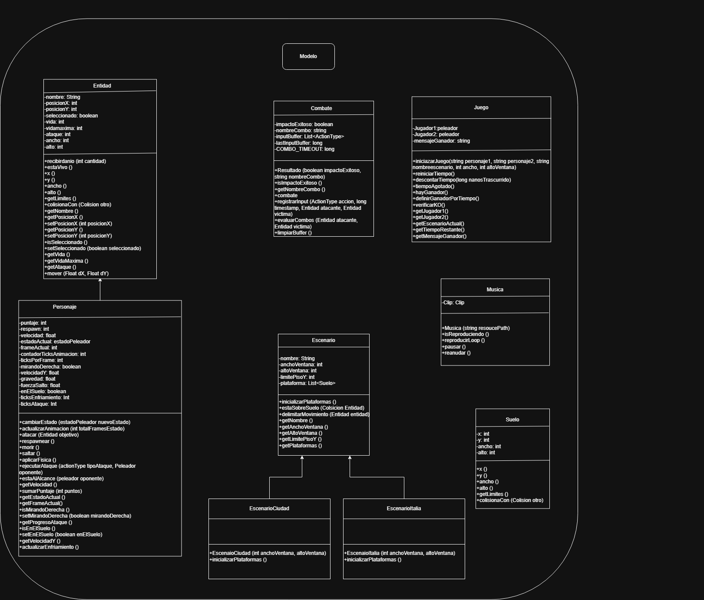

# trabajo-final-POO-2026

# Proyecto: the ultimate last punch 

## 1. Integrantes del Equipo 

- Luna  Joaquin 
- Ojeda Joaquin  
- Luz Clara Gustavo
- Liñeiro Federico

## 2. Dominio y Alcance del Sistema 

### Descripción del Problema
Se busca desarrollar una aplicación de escritorio correspondiente al género fighting game, cosistiendo en batallas cortas entre jugadores. Cada jugador podra elegir entre 2 personajes para jugar.
El juego contará inicialmente con 2 personajes jugables, cada uno con características y habilidades diferentes.

### Objetivo del Sistema
El sistema será un juego funcional y extensible que permitirá al jugador experimentar las mecánicas básicas de un juego de peleas 2D.
El diseño buscará mantener una estructura organizada y modular que permita agregar posteriormente nuevos personajes, habilidades, eventos o combates, aplicando los conceptos del paradigma orientado a objetos vistos durante la materia.

### Funcionalidades Principales (Features)
**Selección de Personaje:
    Los jugadores podrán seleccionar uno de los personajes disponibles.
    Cada personaje contará con características y habilidades diferentes.
**Sistema de Combates:
    Los jugadores controlaran a sus personajes para pelear entre si.
    Los personajes contarán con ataques básicos y habilidades especiales.
    Los combates seran cortos y tendran una cuenta regresiva.
    El primer jugador en reducir la vida de su openente a 0 sera el victorioso. O En caso de que se termine el timpo cronometrado, el jugador con mayor cantidad de vida.
    Durante el combate, ambos jugadores podran generar puntaje por condiciones diferente.
**El objetivo final sera llegar al mayor puntaje posible en los combates para medirse entre los jugadores.
    Puntaje en combate:
    Al dañar al oponente y segun la vida restante al finalizar el combate, los jugadores ganaran puntos.
    El puntaje de cada combate se guardara una base de datos junto a 3 letras como identificativo.
    Cada combate tiene un puntaje individual.
**Interfaz Gráfica (IGU):
    Pantalla de inicio y selección de personaje.
    Visualización del combate, personajes y estado de los jugadores.
    Visualización de puntos de vida y demás información relevante.
    Pantallas para mostrar la victoria, derrota y progreso del jugador.
**Persistencia:
    El sistema permitirá guardar los resultados o puntajes obtenidos por los jugadores.
    Los mejores resultados podrán ser consultados posteriormente mediante un sistema de High Scores almacenado en una base de datos.

## 3. Arquitectura y diseño

### Patron de diseño aplicados

### Patrones de diseño aplicados

Se implementaron tres patrones: Observer, State y Singleton + DAO.

#### 1. Observer (comportamiento)
**Problema:** la vista y el sonido necesitaban enterarse de los cambios del juego (vida, tiempo, ganador) sin que el modelo conociera a la interfaz gráfica. Con el modelo llamando directamente a la vista se rompía el MVC, y la música y los efectos de sonido no tenían dónde engancharse.

**Solución:** `Juego` es el sujeto observable. Mantiene una lista de `ObservadorJuego` y llama a `notificarObservadores()` en cada cambio de estado (por ejemplo, en `avanzarTick`). Hay dos observadores independientes:
- `PanelJuego`: se redibuja solo cuando el modelo cambia.
- `SonidoJuego`: reproduce música y efectos según lo que ocurre en el modelo.

Para sumar otro observador (por ejemplo, un registro de eventos) no hay que modificar `Juego`.

#### 2. State (comportamiento)
**Problema:** lo que puede hacer un peleador depende de su situación (en el suelo, saltando, atacando, herido o muerto). Controlarlo con banderas y condicionales en `Peleador` era frágil y difícil de extender.

**Solución:** `Peleador` es el contexto y delego ese comportamiento en `EstadoPeleador`, con estas implementaciones: `EstadoQuieto`, `EstadoSalto`, `EstadoAtacando`, `EstadoHerido` y `EstadoMuerto`. Cada estado decide qué acciones permite y a qué estado pasa después, por ejemplo cuando termina el ataque o cuando la vida llega a 0. `TipoAnimacion` le indica a la vista qué animación mostrar, sin que la vista conozca los estados.

#### 3. Singleton + DAO (persistencia)
**Problema:** había que guardar los puntajes de cada combate (3 letras, puntos y fecha) de forma permanente, sin que el modelo del juego dependiera de la base de datos.

**Solución:**
- **Singleton (`Conexion`):** garantiza una única conexión a SQLite para todo el programa, ya que dos conexiones al mismo archivo se bloquean entre sí. Se obtiene una sola vez en `main` y viaja por constructor.
- **DAO:** la interfaz `PuntajeDAO` (`guardar`, `mejores`) vive en el modelo y no contiene SQL. Sus implementaciones son `PuntajeDAOSQLite` (única clase que conoce la tabla `puntajes`) y `PuntajeDAOMemoria` (respaldo si la base falla). `Juego` recibe el DAO por constructor y depende solo de la interfaz. La entidad es `Puntaje`, que valida sus datos al crearse.

Al finalizar una partida, el ganador ingresa 3 letras y el puntaje se guarda en `juego.db`.

### Diagramas de diseños:

-1.png>)

-1.png>)

## 4. Stack Tecnológico 

- **Lenguaje:** Java 17
- **IDE:** Visual Studio Code
- **Base de Datos:** SQLite (para persistencia de High Scores)
- **Framework de IGU:** Java Swing
- **Control de Versiones:** Git y GitHub Classroom
